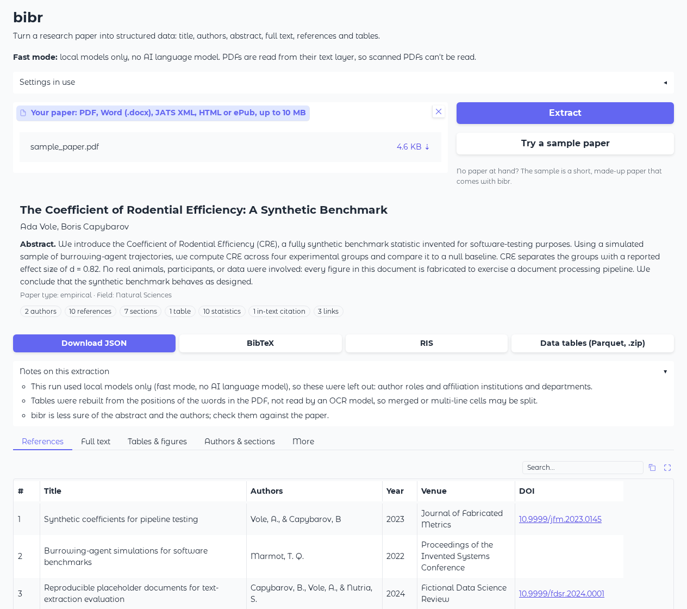

# [](https://bibr.org)

<!-- badges: start -->
[](https://pypi.org/project/bibr/)
[](https://bibr.org)
[](https://www.gnu.org/licenses/agpl-3.0)

[](https://codecov.io/gh/scienceverse/bibr)
<!-- badges: end -->

**bib**liography **r**odent turns scientific papers (PDF, Word DOCX, JATS XML, HTML and
ePub) into structured JSON: title, authors and affiliations, abstract, sections and
sentences, tables, figures, equations and a parsed reference list. Every sentence keeps
its page number and every row an ID, so you can check each field against the source.
It runs on a laptop with no API key. bibr was built for
[Metacheck](https://github.com/scienceverse/metacheck) and metascience research, and works
on its own.

> **Alpha.** Expect bugs and uneven extraction quality, and check important fields against
> the paper. Evaluation is strongest for English-language social-science papers. See
> [where bibr is strong and where it isn't](https://bibr.org/limitations/). The
> [JATS benchmark](https://github.com/scienceverse/bibr-jats-eval), bibr against GROBID on
> 300 open-access papers, is public with its papers, answer key and scores.

## Try it

To try one paper without installing anything, upload it at [try.bibr.org](https://try.bibr.org).

To run bibr on your machine you need [uv](https://docs.astral.sh/uv/getting-started/installation/)
(it installs Python for you). Then:

```bash
uv tool install --python 3.12 bibr
bibr chew --sample -o sample.json   # the sample paper that ships with bibr
bibr inspect sample.json            # a summary of the result
```

If your shell cannot find `bibr` right after installing, run `uv tool update-shell` and
open a new terminal. Your own paper works the same way from any folder:
`bibr chew paper.pdf -o paper.json`.

To use bibr as a Python library in a project, run `uv add bibr` in a uv project (or
`python -m pip install bibr` in an existing Python 3.11–3.14 environment).

There is nothing to configure. With no settings, bibr runs in **fast mode**: local models
only, no LLM and no API key.

- **First run:** bibr downloads about 1.5 GB of models from Hugging Face, once. In our
  test the whole first run took about a minute and a half. `bibr chew paper.pdf --dry-run`
  lists what would download.
- **After that:** in our tests, about half a minute for a full-length paper on a CPU,
  and about 10 seconds for the one-page sample.
- **Scanned PDF?** Fast mode reads the text layer that a born-digital PDF carries. A scan
  has none and needs an OCR backend: see
  [Troubleshooting](https://bibr.org/getting-started/troubleshooting/). Word, JATS,
  HTML and ePub files need no OCR.

## What you get

`bibr inspect` summarizes a result:

```text
$ bibr inspect sample.json
Title: The Coefficient of Rodential Efficiency: A Synthetic Benchmark
Authors: 2 (Ada Vole, Boris Capybarov)
DOI: —
Paper type: empirical

Sections: 7
Sentences: 29
Tables: 1   Figures: 0   Footnotes: 0   Equations: 10

References
  Bibliography entries: 10
...
Validation
  4 warnings to review (abstract, authors, in-text citations) · 1 processing note
...
```

The JSON holds one table per kind of thing, linked by IDs. Trimmed, with `"...": "..."`
standing for the fields left out:

```json
{
  "schema_version": "12.5",
  "metadata": {"title": "The Coefficient of Rodential Efficiency: A Synthetic Benchmark",
               "language": "en", "paper_type": "empirical", "doi": null, "...": "..."},
  "author": [{"author_id": 1, "given": "Ada", "family": "Vole", "orcid": null, "...": "..."}],
  "affiliation": [{"affiliation_id": 1, "author_ids": [1, 2],
                   "text": "Department of Synthetic Studies, Institute for Fictional Research",
                   "...": "..."}],
  "section": [{"section_id": 2, "header": "Abstract", "section_type": "abstract", "...": "..."}],
  "text": [{"text_id": 4, "section_id": 2, "page_number": 1,
            "text": "CRE separates the groups with a reported effect size of d = 0.82.",
            "...": "..."}],
  "eq": [{"eq_id": 1, "text_id": 4, "verbatim": "d = 0.82", "lhs": "d", "comp": "=",
          "rhs": "0.82", "...": "..."}],
  "bib": [{"bib_id": 1, "title": "Synthetic coefficients for pipeline testing", "year": 2023,
           "container": "Journal of Fabricated Metrics", "doi": "10.9999/jfm.2023.0145",
           "...": "..."}],
  "extraction": {"validation": {"errors": 0, "warnings": 4, "...": "..."},
                 "warnings": [{"code": "LLM_SKIPPED", "message": "..."}], "...": "..."}
}
```

[What you get](https://bibr.org/getting-started/output/) walks through every table, the
validation block and the files written next to the result.

## Next steps

**Folders and corpora.**

```bash
bibr chew papers/ -o results/          # every paper in a folder, one JSON each
bibr batch papers/ --out corpus/       # large corpus: resumable, plus Parquet tables
bibr tables results/ --out tables/     # JSON results → one Parquet file per table
bibr references results/ -o refs.bib   # reference lists → BibTeX (.ris, CSL-JSON .json)
```

See [Batch runs](https://bibr.org/guides/batch/).

**Python.**

```python
import bibr

result = bibr.chew("paper.pdf")
print(result.title)
references = result.references.df  # pandas DataFrame
result.save("result.json")

bibr.write_tables(bibr.chew("papers/"), "tables/")  # corpus → Parquet, keyed by paper_id
bibr.write_references(result, "refs.bib")  # reference list → BibTeX, RIS, or CSL-JSON
```

In Jupyter, or anywhere an event loop is already running, use
`result = await bibr.achew("paper.pdf")` instead. See the
[Python guide](https://bibr.org/guides/library/).

**R.** Read the JSON with jsonlite, the Parquet tables with arrow, or hand the JSON to
Metacheck: [R and Metacheck](https://bibr.org/guides/r/).

**Agents and services.** With `uv tool install --python 3.12 'bibr[mcp]'`, `bibr mcp`
exposes extraction as [MCP tools](https://bibr.org/guides/mcp/) for agents such as
Claude Code. With `uv tool install --python 3.12 'bibr[serve]'`, `bibr serve` runs an
[HTTP API](https://bibr.org/guides/deployment/).

**Web demo.** `uv tool install --python 3.12 'bibr[demo]'`, then `bibr demo` opens the
web demo on your machine ([Web demo](https://bibr.org/guides/demo/)).



## More accuracy with an LLM (optional)

Fast mode reads titles, authors, abstracts and references with bibr's own local models.
An LLM helps with the hard cases. Run `bibr setup`. Its first question offers fast
mode; press Enter to keep it. Answer no, and it proposes what fits your machine:

- bibr's fine-tuned local model, on an NVIDIA GPU with 5 GB of memory or more, or on
  Apple Silicon;
- an OCR/LLM server you run yourself; or
- Claude Haiku 5.5 in the cloud, with your Anthropic API key. This sends page images and
  extracted text to Anthropic, and setup asks for your consent first.

Setup writes a `.env` file, installs the provider SDK it configures (the Anthropic
and Google SDKs are the `anthropic` and `google` extras), and can run a one-page test. The
[model guide](https://bibr.org/guides/extraction-models/) compares the options.

With nothing configured, the content of your papers stays on your machine: fast mode
calls no LLM, and Crossref lookups happen only with `--crossref`. One thing to watch: a
key already in your environment counts as a configured LLM. With `GOOGLE_API_KEY` set
(or `LLM_API_KEY`, `LLM_PROVIDER`, `LLM_MODEL` or `LLM_BASE_URL`) and no
`PIPELINE_MODE` in a `.env` from `bibr setup`, a run switches to full mode and calls
that LLM; a Google key alone means Google Gemini, which needs the `google` extra
(`uv tool install --python 3.12 'bibr[google]'`). `--fast` keeps a run local whatever is
set, and `bibr chew paper.pdf --dry-run` shows the mode and where each stage runs.
Details: [What leaves your machine](https://bibr.org/guides/privacy/).

## Documentation

- [Quickstart](https://bibr.org/getting-started/quickstart/) and
  [Troubleshooting](https://bibr.org/getting-started/troubleshooting/).
- [Configuration](https://bibr.org/guides/configuration/): settings, OCR backends,
  LLMs, presets.
- [CLI](https://bibr.org/reference/cli/), [settings](https://bibr.org/reference/settings/)
  and [JSON schema](https://bibr.org/reference/schema/) references.
- [Known limitations](https://bibr.org/limitations/),
  [evaluating extraction quality](https://bibr.org/contributing/evaluation/) on your own
  papers, and [how bibr uses LLMs](https://bibr.org/llm-use/).

## Citation

If you use bibr in research, please cite the software and report the version you
used. Use GitHub's **Cite this repository** button or the
[citation metadata](https://github.com/scienceverse/bibr/blob/main/CITATION.cff)
to generate a citation. When a Zenodo archive is available for your release,
cite its version-specific DOI so readers can identify the exact software used.
Otherwise, cite the repository URL together with the version or commit.

## Contributing

Bug reports, test papers, and contributions are welcome. See
[CONTRIBUTING.md](https://github.com/scienceverse/bibr/blob/main/CONTRIBUTING.md)
for development setup, tests, and pull requests, and the
[project history](https://bibr.org/about/history/) for how the public repository began.

---

## Acknowledgments

Special thanks to **[Daniël Lakens (@Lakens)](https://github.com/Lakens)** and **[Lisa DeBruine (@debruine)](https://github.com/debruine)**, for putting faith and patience in the project, and being generous with their time and insight
 to help make bibr 🦫 better for everyone.

Also thanks to the whole [Metacheck](https://www.scienceverse.org/metacheck/) team, and **TU Eindhoven**.

We are grateful to the open-source projects that bibr builds on:

- [PaddleOCR-VL-1.6](https://huggingface.co/PaddlePaddle/PaddleOCR-VL-1.6) (PaddlePaddle) — default OCR recognizer
- [GLM-OCR](https://huggingface.co/zai-org/GLM-OCR) (Z.ai / Tsinghua University) — explicit compatibility backend and fallback
- [Qwen3.5](https://huggingface.co/Qwen) (Alibaba Qwen) — base of bibr's fine-tuned extraction models
- [GROBID](https://github.com/kermitt2/grobid) — a major source of inspiration for structured scientific document parsing
- [FastAPI](https://fastapi.tiangolo.com) and [Uvicorn](https://www.uvicorn.org) — the `bibr serve` HTTP API
- [PP-DocLayoutV3](https://github.com/PaddlePaddle/PaddleOCR) (PaddlePaddle) — document layout analysis
- [wtpsplit](https://github.com/segment-any-text/wtpsplit) — sentence segmentation
- [Crossref](https://www.crossref.org/) — reference metadata enrichment

---

## License

[AGPL-3.0-or-later](https://github.com/scienceverse/bibr/blob/main/LICENSE.md).
The export schema documents in [`docs/schema/`](https://github.com/scienceverse/bibr/tree/main/docs/schema) are dedicated to
the public domain under [CC0 1.0](https://creativecommons.org/publicdomain/zero/1.0/),
so other tools can adopt the format freely.
