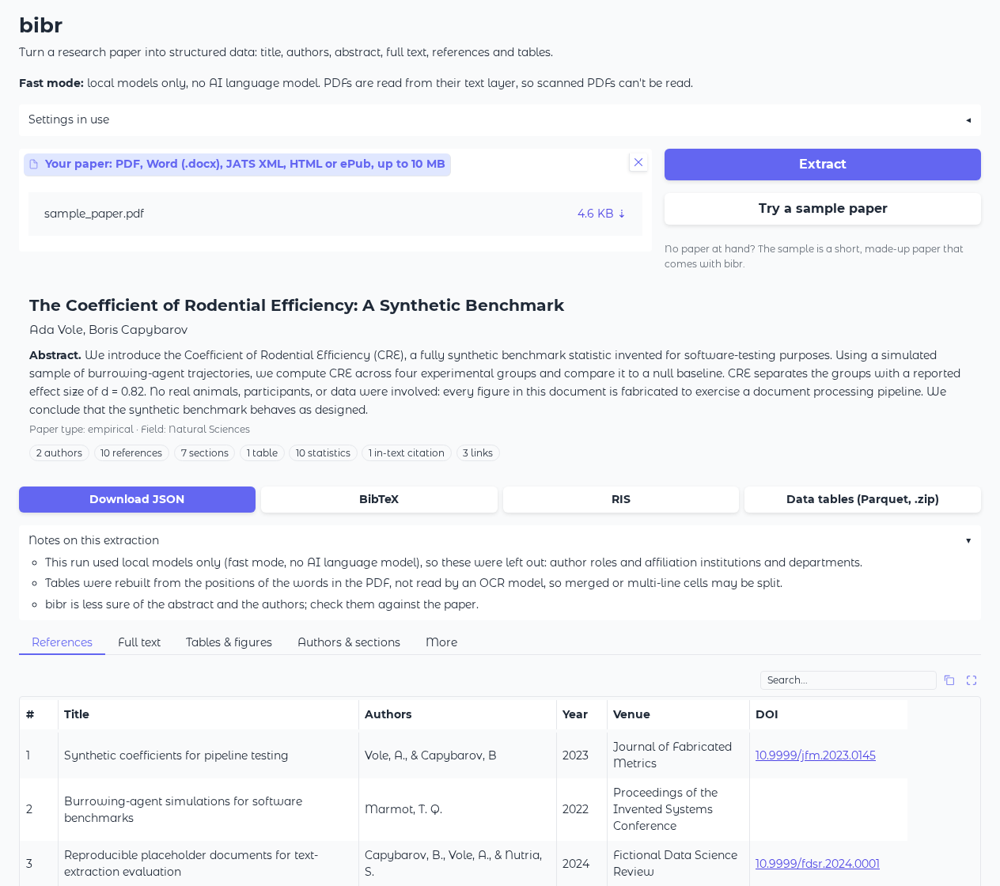

# Web demo

`bibr demo` opens a page in your browser where you drop in one paper and see what bibr
extracts: the title, authors and abstract, the reference list, the full text, the tables,
and downloads in several formats. It runs the same pipeline as `bibr chew`, on the
machine where you start it. Use it to try bibr, to check a paper before you rely on it,
or to show bibr to someone. For many papers, use `bibr chew` on a folder or
[`bibr batch`](batch.md).



## Install the extra

The demo needs Gradio, which comes with the `demo` extra:

```bash
uv tool install --python 3.12 'bibr[demo]'  # bibr installed as a tool
uv add 'bibr[demo]'                         # in a uv project
python -m pip install 'bibr[demo]'          # in a pip environment
```

Without the extra, `bibr demo` stops with a message that names the first two commands.
See [Installation](../getting-started/install.md#extras) for the other extras.

## Start it

```bash
bibr demo
```

(In a uv project, prefix with `uv run`: `uv run bibr demo`.) The demo
prints where it runs and opens that page in your browser:

```text
bibr demo is running at http://127.0.0.1:7860/
  Fast mode: local models only, no AI language model. PDFs are read from their text layer, so scanned PDFs can't be read.
  Press Ctrl+C to stop.
```

Press **Ctrl+C** in that terminal to stop it. If port 7860 is taken (another demo is
running, for example), it says so and suggests the next one; pick a port with
`--port`, as in `bibr demo --port 7861`.

The terminal shows warnings only. `--log-level info` shows bibr's log as well, and
`--log-level debug` everything.

With nothing configured, the demo runs in **fast mode**: local models only, no LLM
(large language model), no API key, and PDFs read from their text layer. On a fresh
machine, the demo shows a notice under the status line (and in the terminal banner)
telling you how much will download from Hugging Face on the first paper and why the first
paper takes longer; once the first paper finishes, the notice disappears and later papers
reuse the cached, loaded models.

## What you see

1. A line under the title says how the demo reads papers, followed by the first-paper
   notice until the first run warms the models and an **Extraction mode** toggle
   (**Fast** vs. **Full**). When an LLM is configured (and `--fast` was not passed), you
   can switch between Fast and Full right on the page without restarting the demo.
   **Settings in use** opens the details: the mode, how PDF text is read, the LLM, and
   the reference parser (`bibr demo --help` lists the startup options).
2. Choose a paper: a PDF, Word (.docx), JATS XML, HTML or ePub file, up to 10 MB by default. Then
   click **Extract**. **Try a sample paper** runs the short, made-up paper that ships
   with bibr, the one `bibr chew --sample` reads, so you can try the demo without a
   paper at hand.
3. The result starts with what you would look for first: the title, the authors (`*`
   marks a corresponding author), the journal, year, volume, pages and DOI (a link to
   doi.org), the keywords and the abstract. Below them are the paper type and field,
   and counts of what was found.
4. **Notes on this extraction** says in plain words what the run did not do (a fast run
   makes no LLM call, so it leaves out author roles, for example) and which fields
   bibr is less sure of, so you can check them against the paper. The full list is in
   `extraction.warnings` and `extraction.validation` of the JSON
   ([What you get](../getting-started/output.md#validation-and-warnings)).
5. The tabs:

    | Tab | What it shows |
    |---|---|
    | **References** | The reference list: title, authors, year, venue and DOI, with a search box. With Crossref enrichment on (`CROSSREF_ENRICH=true`, see [Configuration](configuration.md#crossref-enrichment)), the Crossref matches are listed under it. |
    | **Full text** | The text by section, with figure and table captions where they occur, and the footnotes at the end. |
    | **Tables & figures** | Each table with its caption, and the figures with their captions. |
    | **Authors & sections** | The authors with affiliation, ORCID, email and corresponding author; the section headings and the kind of section each was read as. |
    | **More** | In-text citations and what each points to, statistics reported in the text (such as t(28) = 2.10), links, and the whole JSON. |

When a paper cannot be read, the result area says what happened and what to do next,
and stays until you run another paper. Choosing another file clears the last
paper's results.

## Downloads

| Button | What you get |
|---|---|
| **Download JSON** | The full export, the same file `bibr chew -o` writes. See [What you get](../getting-started/output.md). |
| **BibTeX**, **RIS** | The paper's reference list, for a reference manager. `bibr references` writes the same from saved exports. Shown when the paper has references. |
| **Data tables (Parquet, .zip)** | One Parquet file per table (authors, references, sentences, ...), keyed by `paper_id`, as `bibr tables` writes them. |
| **Download these tables as CSV (.zip)** | On the **Tables & figures** tab: one CSV file per table printed in the paper. |

With `FIGURE_IMAGES=true` the JSON carries the figure images, and a **JSON without
images** button gives the same file without them.

The demo deletes uploaded papers and downloads after an hour (see
[Settings for a shared demo](#settings-for-a-shared-demo)), so save what you need.

## Scanned PDFs

In fast mode the demo reads a PDF's text layer: the text a born-digital PDF carries. A
scan has only page images, so the demo says **This PDF is a scan, so the demo can't read
it**. Word, JATS XML, HTML and ePub files never need OCR (optical character recognition,
which reads text from page images).

To read scans, start the demo with an OCR backend:

- `bibr demo --ocr anthropic` sends the page images to Anthropic's cloud model. Set
  `ANTHROPIC_API_KEY` first. The page images leave your machine
  ([What leaves your machine](privacy.md)).
- On a machine with an NVIDIA GPU or Apple Silicon, `bibr setup` can configure a local
  OCR model; restart the demo after it. [Configuration](configuration.md#ocr-backends)
  lists every backend, and `bibr doctor` shows which can run on your machine.

The hosted demo at [try.bibr.org](https://try.bibr.org) reads scans too.

## An LLM, presets and other options

The demo picks its mode as `bibr chew` does. With an LLM configured (by `bibr setup`, or
`GOOGLE_API_KEY` or `LLM_*` settings already in the environment), it runs in **full
mode**, and the configured LLM reads what the local models are unsure of; parts of the
paper's text then go to that LLM's provider. The options:

| Option | What it does |
|---|---|
| `--fast` | Fast mode whatever is configured: no LLM call. |
| `--full` | Full mode, with the configured LLM. |
| `--llm BACKEND` | The LLM backend: `cloud`, or a managed local server (`local`, `vllm`, `vllm-mlx`, `rapid-mlx`, `llama-cpp`, `llmster`). |
| `--refs llm` / `--refs ner` | Parse references with the LLM, or with the local model (the default). |
| `--ocr BACKEND` | The OCR backend, as above. |
| `--memory MODE` | `aggressive`, `balanced` or `keep_all`: how many models stay loaded at once ([Pages and memory](configuration.md#pages-and-memory)). Left out, bibr chooses from the machine. |
| `--presets` | A preset menu under **Settings in use**, listing the presets saved with `bibr preset save NAME` ([Presets](configuration.md#presets)). A switch applies to everyone using the demo. |

`--fast` together with `--llm` or `--refs llm` is refused, since both call an LLM.

## Settings for a shared demo

These are process environment variables, not `.env` keys: set them in the shell that
starts the demo. In PowerShell, for example: `$env:DEMO_CACHE_TTL_SECONDS="1800"`.

- `DEMO_MAX_FILE_SIZE_MB` (default 10) limits uploads. A larger upload is refused while
  it arrives. A value that is not a positive whole number stops the demo at start.
- `DEMO_CACHE_TTL_SECONDS` (default 3600) is how long uploaded papers and downloads are
  kept. Gradio looks for old files every five minutes, so a file is deleted at most five
  minutes after it reaches that age. All of them are deleted when the demo stops. `0`
  keeps them. Any other value that is not a whole number of seconds stops the demo at
  start.

While the demo deletes its files, it leaves the OCR disk cache off unless you set
`CACHE_OCR` yourself. With `DEMO_CACHE_TTL_SECONDS=0` it turns that cache on, so a paper
you run again skips OCR. The cache keeps each paper's OCR text, with no expiry, in
`CACHE_OCR_DIR` (default `$XDG_CACHE_HOME/bibr/ocr`, or `~/.cache/bibr/ocr` when
`XDG_CACHE_HOME` is unset). On a demo other people upload to, keep the cleanup on and do
not turn `CACHE_OCR` on, in the shell or in `.env`.

Gradio deletes the files but not the folders they were in: an empty folder for each
paper's downloads, and one named after a hash of each uploaded paper. Its cleanup also
runs as one background task that stops for good after an error. Unless `GRADIO_TEMP_DIR`
is set, `bibr demo` creates a private `bibr-demo-*` temp folder (mode 0700) and removes it
on exit, rather than using Gradio's shared `<tmp>/gradio`. For a hosted demo on Linux,
give the demo a temp folder of your own with `GRADIO_TEMP_DIR` and sweep it from
cron as well, with an age above `DEMO_CACHE_TTL_SECONDS`. For the default hour, every 15
minutes:

```bash
# Before starting the demo:
export GRADIO_TEMP_DIR=/srv/bibr-demo/tmp
# crontab entry (one line):
*/15 * * * * find /srv/bibr-demo/tmp -mindepth 1 -type f -mmin +75 -delete; find /srv/bibr-demo/tmp -mindepth 1 -type d -empty -mmin +5 -delete
```

The demo turns off Gradio's usage analytics (`GRADIO_ANALYTICS_ENABLED`) unless you set
that variable yourself.

## Security: sharing the demo

By default the demo listens on `127.0.0.1`, so only your own machine can reach it.
Anyone who reaches a demo can process papers on your machine, and on your LLM quota in
full mode, and with `--presets` switch the configuration for everyone. So:

- Without `GRADIO_PASSWORD`, `bibr demo` refuses to start with `--share` (a temporary
  public link from Gradio) or with a `--host` other than a loopback address, such as
  `0.0.0.0`. It exits with status 2 before any model loads.
- With `GRADIO_PASSWORD` set, the page asks for a username and that password. The
  username is `GRADIO_USERNAME`, or `demo` when it is unset.
- `--allow-unauthenticated` starts it open to anyone who reaches it. Use it only on a
  network you trust.

To show the demo to someone elsewhere, run it on the machine that has bibr configured,
with a username and a strong password. In PowerShell:

```powershell
$env:GRADIO_USERNAME="supervisor"
$env:GRADIO_PASSWORD="replace-with-a-long-random-password"
uv run bibr demo --share
```

On macOS or Linux, use `export GRADIO_USERNAME=...` and `export GRADIO_PASSWORD=...`
instead. The demo prints the public link. Send the link and the password separately.
That machine downloads the models and processes the uploaded papers; the other person
needs only a browser. Treat a share link as a temporary evaluation endpoint, stop the
demo after the session, and do not use it for confidential papers unless the hosting
and data handling have been approved.

For a production service, see [Production deployment](deployment.md).
